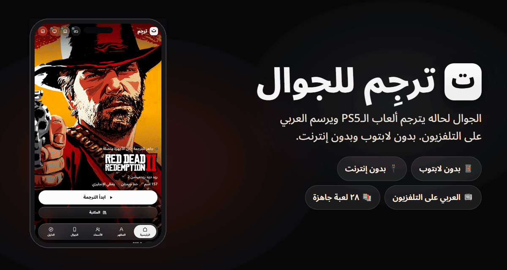
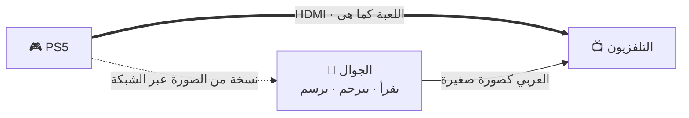
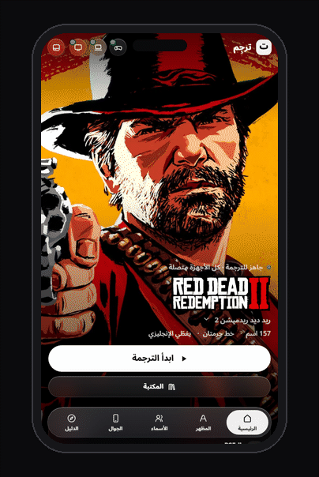
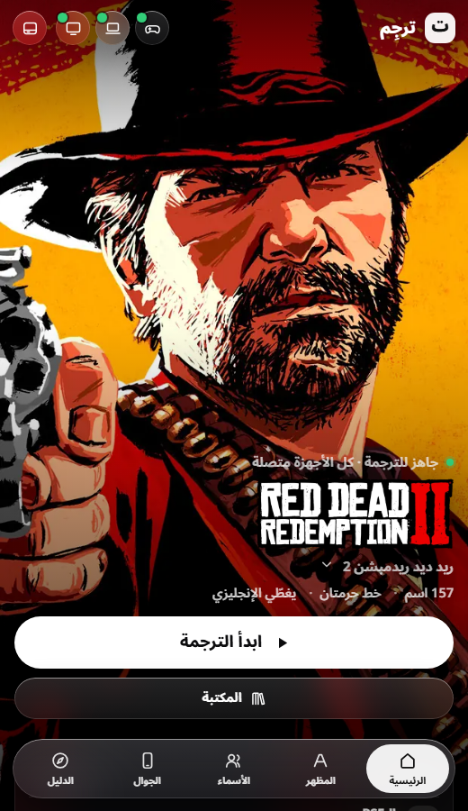
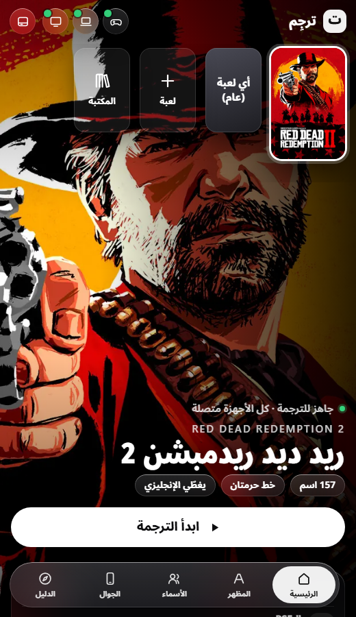
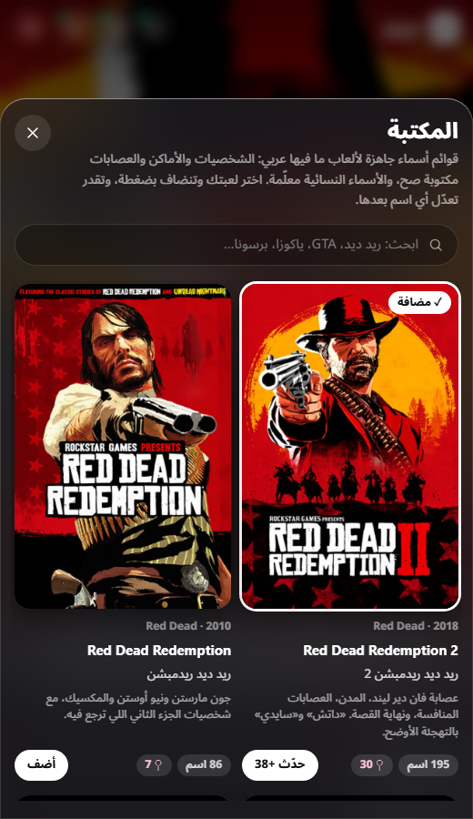

 

**[🎬 وش يسوي؟](#what) · [✨ المميزات](#features) · [⬇️ التثبيت](#install) · [🎮 كل مرة](#play) · [🤖 الذكاء الاصطناعي](#ai) · [❓ أسئلة](#faq)**

## 🎬 وش يسوي؟

الجوال ياخذ نسخة من صورة الـPS5 عن طريق شبكة البيت، يقرأ سطر الحوار الإنجليزي، **يترجمه داخل الجوال**، ويرسل العربي لتطبيق ترجِم على التلفزيون اللي يرسمه فوق اللعبة في نفس المكان. لعبتك ويدك ما يتغيّر فيهم شي، وما تحتاج لابتوب ولا إنترنت.

على Galaxy S20 FE السطر ياخذ حوالي **عُشر ثانية** والشاشة شغّالة.

## ✨ المميزات

<table>
<tr>
<td width="44%" align="center"></td>
<td valign="top">

- 📱 **بدون لابتوب:** الجوال يسوي كل الشغل لحاله.
- 🔌 **بدون إنترنت:** القراءة والترجمة داخل الجوال.
- 🎮 **ما يلمس اللعبة:** الـPS5 موصول بالتلفزيون مثل ما هو.
- 🖼️ **لعبتك هي الخلفية:** صورتها الرسمية، ووقت الترجمة البث المباشر. وتختار بين شكلين: «سينما» أو «رف الألعاب».
- 🧠 **يفهم كلام الألعاب:** أسماء الشخصيات والأماكن، وكلمات كل لعبة («the fence» = تاجر البضائع المسروقة)، وعامية الويسترن والمافيا والشوارع.
- 👥 **يعرف مين يكلّم:** المذكر للرجل والمؤنث للمرأة.
- 🎨 **لكل لعبة شكلها:** الخط والحجم واللون والخلفية والموضع.
- ✍️ **القلم جنب أي سطر:** اكتب الترجمة بطريقتك وتنحفظ.
- 🔁 **ملف اللعبة:** صدّر أسماءك وتعديلاتك وأرسلها واتساب، أو افتح ملف وصلك مباشرة. نفس ملفات نسخة الكمبيوتر.

</td>
</tr>
</table>

### 📚 مكتبة ٢٨ لعبة

قوائم أسماء وكلمات جاهزة لألعاب ما فيها عربي: ريد ديد، قراند (حتى **GTA 6**، أسماؤها من موقع روكستار الرسمي والعروض)، ياكوزا، ذا لاست أوف أس، سايلنت هيل ٢، بلدرز قيت ٣، بيرسونا ٥ وغيرها. ضغطة وحدة وتنضاف.

<table>
<tr>
<td align="center" width="33%"><b>الرئيسية</b> </td>
<td align="center" width="33%"><b>رف الألعاب</b> </td>
<td align="center" width="33%"><b>المكتبة</b> </td>
</tr>
</table>

## ⬇️ التثبيت

1. من [صفحة الإصدارات](../../releases/latest) نزّل **`Tarjim-Phone.apk`** وثبّته (اسمح بالتثبيت من هذا المصدر لو سألك).
2. تطبيق ترجِم لازم يكون على التلفزيون. يتثبّت مرة وحدة من [نسخة الكمبيوتر](https://github.com/aketo1/tarjim).

<b>🛠️ أول مرة: الإعداد</b> (اضغط)

 

افتح التطبيق وروح لـ**«الإعداد»**:

1. **عنوان التلفزيون:** افتح ترجِم على التلفزيون وتلقاه مكتوب بالأصفر.
2. **عنوان الـPS5:** الإعدادات ‹ الشبكة ‹ عرض حالة الاتصال ‹ عنوان IP.
3. **اربط الـPS5:**
   - على الـPS5 أضف مستخدم بحساب PSN **ثاني** (مجاني) وفعّل: الإعدادات ‹ النظام ‹ اللعب عن بُعد ‹ تمكين اللعب عن بُعد.
   - اضغط «اربط الـPS5» وسجّل دخول بالحساب الثاني في صفحة Sony.
   - على الـPS5 بالحساب الثاني: الإعدادات ‹ النظام ‹ اللعب عن بُعد ‹ ربط جهاز، واكتب الأرقام الثمانية في الجوال.

> 🔐 **ليش حساب ثاني؟** لو اتصل الجوال بنفس الحساب اللي تلعب فيه، الـPS5 يفصل يدك.

## 🎮 كل مرة

1. شغّل لعبتك بحسابك العادي.
2. افتح ترجِم، اختر اللعبة، واضغط **«ابدأ الترجمة»**.
3. اضغط **«عتّم الشاشة»** وخلّ الجوال على الشاحن.

> 📵 **لا تقفل شاشة الجوال.** أندرويد يبطّئ التطبيق لو انطفت الشاشة: الترجمة تتأخر ثانية ونص ثم يفصل. زر التعتيم يخلي الشاشة سوداء وما تستهلك شي تقريباً.

## 🤖 انبنى بمساعدة الذكاء الاصطناعي

**ترجِم انبنى بمساعدة الذكاء الاصطناعي:** الفكرة والطلبات من صاحب المشروع بالعربي، و**Claude** (من Anthropic، عن طريق Claude Code) يكتب الكود ويجرّبه ويقيس سرعته ويصلّح أخطاءه. وساعد **Gemini** من Google في جولة تحسين العربي.

| اليوم | وش صار |
| --- | --- |
| ١٥ نوفمبر ٢٠٢٦ | نسخة الكمبيوتر الأولى: العربي يطلع على التلفزيون فوق اللعبة |
| ١٦ نوفمبر | نسخة الجوال: الجوال لحاله يقرأ ويترجم ويرسم |
| ١٧ نوفمبر | مكتبة الألعاب، والإكس بوكس (تجريبي) |
| ١٨ نوفمبر | الشكل الجديد بصور الألعاب، عربي أوضح، وكلمات ٢٨ لعبة |

## ❓ أسئلة سريعة

<b>الترجمة هنا مثل نسخة الكمبيوتر؟</b>

 
الواجهة والقوائم والكلمات نفسها، لكن المترجم اللي يشتغل داخل الجوال أصغر، فالجودة أقل شوي من نسخة الكمبيوتر.

<b>ليش الإنجليزي يتغطّى بخلفية داكنة؟</b>

 
عشان ما يبان تحت العربي. شكل الخلفية تغيّره من «المظهر».

<b>يشتغل مع الإكس بوكس؟</b>

 
مكتوب كتجربة، لكن ما انجرّب على إكس بوكس حقيقي للحين.

<b>انقطعت الصورة؟</b>

 
التطبيق يعيد الاتصال لحاله. لو ما رجع، تأكد إن الجوال والـPS5 والتلفزيون على نفس الشبكة.

---

<b>For developers</b>

Everything technical is in [`docs/REPORT.md`](docs/REPORT.md). The app is built by GitHub Actions on every push to `main` and published to the `latest` release. The pictures in this page come from the laptop program's `launcher/make_readme_media.py`; the page itself is the laptop program's interface (`app/web`), copied in by its `launcher/sync_phone_web.py`.

Built with the help of AI: Claude (Anthropic) through Claude Code, and Gemini (Google) for one round of Arabic wording.

Built on the Android client of [chiaki-ng](https://github.com/streetpea/chiaki-ng) (AGPL-3.0, see `COPYING` and `LICENSES/`). Personal, non-distributed project. The games' pictures belong to their publishers.

